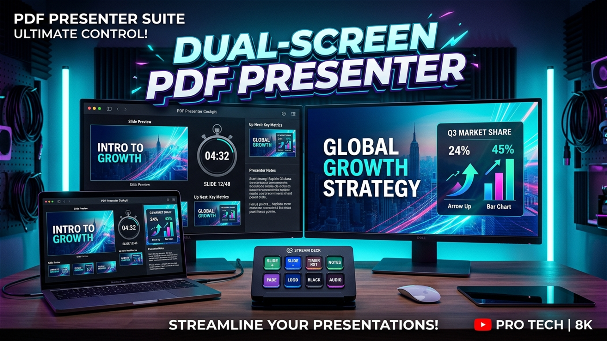

<div align="center">

# 📽️ PDF Presenter Suite

### Professional Dual-Screen Presentation Software for Keynotes, Conferences & AV Teams

<p>
  <a href="https://github.com/SHARUNJOSEPH/pdf-presenter/releases/download/v1.2.9/PDF.Presenter.Suite.Setup.1.2.9.exe">
    
  </a>
  <a href="https://github.com/SHARUNJOSEPH/pdf-presenter/releases/download/v1.2.9/PDF.Presenter.Suite-1.2.9-arm64.dmg">
    
  </a>
  <a href="https://github.com/SHARUNJOSEPH/pdf-presenter/releases/download/v1.2.9/PDF.Presenter.Suite-1.2.9.dmg">
    
  </a>
  <a href="https://apps.microsoft.com/detail/9NS3LKFXHBXW">
    
  </a>
  <a href="https://github.com/SHARUNJOSEPH/pdf-presenter/releases/latest">
    
  </a>
</p>

<p>
  <a href="https://github.com/SHARUNJOSEPH/pdf-presenter/releases/latest">
    
  </a>
  <a href="https://github.com/SHARUNJOSEPH/pdf-presenter/releases">
    
  </a>
  <a href="LICENSE">
    
  </a>
  <a href="https://www.linkedin.com/in/joseph-sharun/">
    
  </a>
</p>

> 🎁 **1-Year Community Pro Gift**: The Enterprise Pro edition is pre-activated by default for all users who download the app during the first year (until October 1, 2027) with key `PRO-13EC-56E3-BA69-732E`! Unlocks NDI IP broadcast, stage confidence monitors, Bitfocus Companion integration, and watermark branding for free.

<br/>



<br/>
<br/>

</div>

---

## 📥 Direct Downloads & Installation Links

Choose your operating system to begin an immediate 1-click download:

| Operating System | Package Type | Direct 1-Click Download Link | Notes |
| :--- | :--- | :--- | :--- |
| **Windows 10 / 11** | Setup Installer | [**⬇️ Download Windows Setup (.exe)**](https://github.com/SHARUNJOSEPH/pdf-presenter/releases/download/v1.2.9/PDF.Presenter.Suite.Setup.1.2.9.exe) | **Recommended for Windows.** Multi-language installer, auto desktop shortcut, in-app updates. |
| **Microsoft Store** | Certified Store App | [**🛍️ Install from Microsoft Store**](https://apps.microsoft.com/detail/9NS3LKFXHBXW) | Verified and signed by Microsoft Corporation with automatic silent updates. |
| **macOS (Apple Silicon)** | M1 / M2 / M3 / M4 | [**🍎 Download Apple Silicon (.dmg)**](https://github.com/SHARUNJOSEPH/pdf-presenter/releases/download/v1.2.9/PDF.Presenter.Suite-1.2.9-arm64.dmg) | Native ARM64 disk image for modern MacBooks, Mac mini, and Mac Studio. |
| **macOS (Intel x64)** | Intel Core Macs | [**🍏 Download Intel Mac (.dmg)**](https://github.com/SHARUNJOSEPH/pdf-presenter/releases/download/v1.2.9/PDF.Presenter.Suite-1.2.9.dmg) | Optimized for Intel-based Macs. |
| **macOS Portable** | Universal Zip | [**📦 Download macOS (.zip)**](https://github.com/SHARUNJOSEPH/pdf-presenter/releases/download/v1.2.9/PDF.Presenter.Suite-1.2.9-arm64-mac.zip) | Standalone portable macOS application bundle. |
| **All Releases & Assets** | GitHub Release Hub | [**🌐 Browse All Releases & Source Code**](https://github.com/SHARUNJOSEPH/pdf-presenter/releases/latest) | View checksums, blockmaps, and previous versions. |

> 💡 **Tip:** In-app updates are now built-in with Resolume Arena-style background downloads. Once installed, future updates download and install automatically within the app with zero browser redirects.

---

## ✨ What's New in v1.2.9

- **🖥️ 4K Subpixel-Free Dissolve Compositor & Rapid-Scrub Engine**:
  - Eliminated the 1px subpixel edge seam and mid-scrub flicker line on 4K displays via integer-aligned flex centering (`inset: 0; margin: auto; contain: paint`), synchronized outgoing/incoming canvas bounds prior to opacity blending, and instant mid-scrub transition commit when rapidly advancing slides.
- **📑 Multi-Deck Conference Playlist & In-Flight Queue Sync**:
  - Dragged and freshly loaded PDFs on the Launcher hub automatically synchronize with the multi-deck playlist queue, and new decks can be queued and switched mid-show (`LOAD_DOCUMENT`) without closing or interrupting the audience screen.
- **📡 NDI / Live MJPEG IP Broadcast Streaming**:
  - Full server-side MJPEG streaming pipeline (`GET /api/stream/program.mjpg`, `GET /api/stream/alpha.mjpg`, `GET /api/ndi/status`) enabling **OBS Studio**, **vMix**, and **TriCaster** to ingest live program and alpha-key feeds over LAN.
- **🎮 GPU Hardware Adapter Telemetry & Cadence Diagnostics**:
  - Expanded the 1-click Diagnostic Bug Report Generator with hardware GPU adapter enumeration (device name, driver version, dedicated VRAM) and slide transition cadence analysis.
- **📱 Responsive Presenter Cockpit Top Bar**:
  - Graduated responsive layout (`1366px`, `1200px`, `1050px`) and localized Tools dropdown menu preventing toolbar overflow on compact laptop screens and high-DPI displays.

---

## 🌟 Key Features

- **📡 NDI / IP Broadcast Video Streaming (OBS, vMix & TriCaster)**:
  - **Live Program & Alpha Key Feeds**: Stream clean slide output (`program.mjpg`) and transparency mattes (`alpha.mjpg`) directly over HTTP/LAN into broadcast switchers without capture cards.
  - **Zero-Latency Snapshot Endpoints**: Instant frame snapshots (`/api/stream/program/snapshot`, `/api/stream/alpha/snapshot`) and live stream telemetry (`/api/ndi/status`).
- **📑 Multi-Deck Conference Playlist & Rehearsal Metrics**:
  - **Seamless In-Flight Deck Switching**: Queue multiple speaker presentations in order and switch decks live on stage while keeping the audience display window locked and active.
  - **Per-Slide Timing & Speaker Notes Export**: Track rehearsal pacing per slide and export complete speaker notes.
- **🏷️ Event Watermark & Live Audience Lower-Third Banner**:
  - **Custom Event Branding Overlay**: Position custom text or PNG event watermarks with adjustable opacity and scale on the audience stage.
  - **Broadcast Lower-Third Ticker**: Trigger live lower-third banners (`POST /api/banner`) routed to the Audience Stage, Presenter Cockpit, Stage Confidence Monitor, or all displays simultaneously.
- **🐞 Native Diagnostic Bug Report Generator & Flicker Troubleshooting**:
  - **1-Click Hardware, GPU & Display Compatibility Audit**: Enumerates connected displays, GPU hardware adapters (driver version & VRAM), Chromium compositor flags, mixed DPI scaling, and refresh rate disparities (including 50Hz PAL/EBU broadcast standards).
  - **Slide Flicker & Cadence Heuristic Analysis**: Automatically checks for mismatched display scale factors (e.g. 1.5x vs 1.0x), refresh rate disparities (144Hz vs 60Hz), and dissolve transition cadence.
  - **Instant Export & Privacy Sanitization**: Copy formatted GitHub Markdown or save directly to a `.md` file with all personal file paths automatically sanitized.
- **🎬 Pro Studio Stage Confidence Display**:
  - **4 Instant Broadcast Templates**: Switch seamlessly between 🎬 **Dual Cinema** (balanced live/next split), 📝 **Prompter Focus** (expanded teleprompter), ⏱️ **Timekeeper Focus** (giant stage timer), and 🖥️ **Single Live Mirror** (full-width audience mirror).
  - **Optimized for Stage Distance**: High-contrast, glare-resistant typography and responsive multiviewer layout readable from 20 to 40+ feet away.
  - **Independent Confidence Output**: Launch on dedicated onstage speaker monitors, foldback screens, or teleprompter glass.
- **📝 High-Readability Stage Teleprompter**:
  - **Auto-Scrolling Speaker Notes**: Hands-free auto-scrolling with real-time speed control (`[` to slow down, `]` to speed up, `Space` to pause/resume).
  - **Live Script Preview**: Keep your speaking cadence smooth without looking down at a laptop screen.
- **📢 Silent Stage Cue to Speaker Monitor**:
  - **Direct Backstage-to-Stage Messaging**: Technical directors and event managers can send silent instructions (*"Wrap up in 2 min"*, *"Mic check"*, *"Q&A Starting"*) directly to the speaker's monitor.
  - **High-Visibility Broadcast Banner**: Prominent pulsing stage overlay with auto-dismiss countdown timer so the speaker never misses a critical cue.
- **⏱️ Smart Keynote Countdown Timer & Overtime Alert**:
  - **Keynote Countdown Mode**: 5m, 10m, 15m, 20m, 30m, 45m, and 60m presets.
  - **Multi-Phase Color Alerts**: Normal (Cyan) → Warning (Pulsing Amber at ≤5m) → Critical (Pulsing Red at ≤1m) → **Flashing Red Overtime (`+MM:SS`)** when presentation exceeds allotted time.
- **Enterprise 11-Language Internationalization (i18n)**:
  - **11 Fully Localized Languages**: English (`en`), Español (`es`), Français (`fr`), Deutsch (`de`), 简体中文 (`zh`), 日本語 (`ja`), العربية (`ar`), Português (`pt`), हिन्दी (`hi`), Русский (`ru`), and Italiano (`it`).
  - **Auto-Detection**: Automatically detects the host operating system's native language upon launch.
  - **Arabic Right-to-Left (RTL) Support**: Complete RTL interface flow with strict bidirectional isolation (`unicode-bidi: isolate`) on timers, clocks, and slide counts to prevent digit inversion.
  - **Zero-Reload Live Synchronization**: Switching languages in the Presenter cockpit propagates instantaneously to the Audience display via `BroadcastChannel` without page reloads.
- **Multi-Screen Intelligent Routing**:
  - Automatically identifies all connected displays (primary screen, external monitors, HDMI projectors).
  - Clean fullscreen feed for the audience (no browser tabs, toolbars, or mouse pointers).
  - Dedicated **Presenter Cockpit** auto-maximized on your primary display.
- **Recent Presentations History**:
  - Quick-launch list on the setup screen remembers your last 5 opened slide decks.
  - 1-Click to reopen frequently used PDF presentations without searching folders.
- **🎯 PowerPoint-Style Direct Slide Number Jump (`[N] + Enter`)**:
  - Jump directly to any slide without opening any menu: type slide numbers on the keyboard (e.g. `7` + `Enter` or `14` + `Enter`).
  - Sleek glassmorphic HUD toast displays real-time key buffer and auto-dismisses smoothly.
- **🖥️ Stage Confidence Monitor Output Control**:
  - Independent Enable / Disable feed toggle across toolbar, settings modal, and Companion API (`POST /api/confidence/toggle`) to start or stop the floor monitor feed at will.
- **Slide Sorter & Quick Jump Grid (`G`)**:
  - Instant visual grid modal displays high-resolution thumbnails for every slide in your deck.
  - Jump directly to any slide (e.g., Slide 15 during audience Q&A) without scrolling through intermediate slides in front of the audience.
- **Live Presentation Timer & Real-Time Wall Clock**:
  - Live stopwatch timer with Start/Pause/Reset controls.
  - Real-time digital clock displays local time-of-day so you never run over your session schedule.
- **PowerPoint-Style Adjustable Presenter Cockpit**:
  - **Draggable Vertical Splitter**: Adjust width between Current Slide and Sidebar on the fly.
  - **Draggable Horizontal Splitter**: Expand Speaker Notes into a tall teleprompter view or enlarge Next-Slide Preview.
  - **Layout Memory**: Saves custom panel proportions in `localStorage` across sessions (double-click to reset).
  - **Large Live Preview** of current slide with responsive aspect re-fitting.
  - **Next-Slide Glance Preview** for seamless speaking flow.
  - **Visual Slide Strip** with jump-to-slide thumbnails.
  - **Per-Slide Speaker Notes** with instant local auto-saving.
- **Silky 1.0s True Dissolve Transitions (4K Subpixel-Hardened)**:
  - Double-buffered, integer-snapped canvas architecture eliminates all white flashes, 1px subpixel edge lines, and rapid-scrub flickering on 4K projectors and LED walls.
  - Smooth dissolve animation ensures a cinematic keynote experience.
- **Production Hardened & Developer Tools Lock-down**:
  - Standard Chromium menus and development tools are cleanly stripped from production builds.
  - Inspection shortcuts (`F12`, `Ctrl+Shift+I`) are blocked in release packages for a polished native desktop feel.
- **Interactive Tools & Keyboard Control**:
  - 🔴 **Virtual Laser Pointer**: Centered and synced live to the audience screen (`L`).
  - ✏️ **Digital Annotation Pen & Highlighter**: Multi-color annotation palette and 24px highlighter (`P`).
  - 🔦 **Stage Spotlight (`S`)**: Focus audience attention on key slide regions.
  - ⬛ **Instant Blackout & Whiteout (`B` / `W`)**: Direct stage attention to the speaker.
  - 🗂️ **Slide Sorter Grid (`G`)**: Open bird's-eye slide grid to jump instantly to any slide.
  - 🛑 **Quick Exit (`Esc`)**: Press Esc anytime to close modals or exit presenter view cleanly.
  - ⛶ **Fullscreen Toggle (`F11`)**: Borderless distraction-free presenter view.
- **Bitfocus Companion & Stream Deck Integration**:
  - Built-in lightweight HTTP REST & WebSocket API on port `3000`.
  - **1-Click Companion Preset Export**: Generates ready-to-import `.companionconfig` files with 15 pre-styled colored keys (Next, Prev, Blackout, Timers, Laser).
  - 1-Click **"📋 Copy"** buttons for all API endpoints and network IP addresses.
  - Control slides, blackout, banners, NDI streams, and timers directly from hardware production switchers or Stream Deck panels.
- **In-App Software Update Checker**:
  - Built-in GitHub Releases update engine checks for new builds automatically.
  - One-click update checking in the About dialog with Resolume-style in-app background download & install.

---

## 🚀 Getting Started

### Option 1: Standalone Installers (No Node.js Required)

#### 🪟 Windows
1. Download the [**Latest Windows Installer (.exe)**](https://github.com/SHARUNJOSEPH/pdf-presenter/releases/latest) or install directly from the [**Microsoft Store**](https://apps.microsoft.com/detail/9NS3LKFXHBXW).
2. Run the installer or open the application.
3. Select your PDF presentation (or click **Use Demo Deck**) and click **"Start Dual-Screen Presentation"**.

#### 🍎 macOS (Apple Silicon & Intel)

##### Method A: Homebrew Cask (Recommended — Bypasses Browser Quarantine)
Install directly via [Homebrew](https://brew.sh) without browser quarantine prompts:
```bash
brew tap SHARUNJOSEPH/pdf-presenter https://github.com/SHARUNJOSEPH/pdf-presenter
brew install --cask pdf-presenter
```
*Or single-line install directly from the formula:*
```bash
brew install --cask https://raw.githubusercontent.com/SHARUNJOSEPH/pdf-presenter/main/Casks/pdf-presenter.rb
```

##### Method B: Drag-and-Drop DMG Installer
1. Download the [**Apple Silicon (.dmg)**](https://github.com/SHARUNJOSEPH/pdf-presenter/releases/latest) (for M1/M2/M3/M4) or [**Intel (.dmg)**](https://github.com/SHARUNJOSEPH/pdf-presenter/releases/latest).
2. Open the `.dmg` — you will see **PDF Presenter Suite**, the **/Applications** folder shortcut, and a **`READ_ME_FIRST.txt`** guide right in the window.
3. Drag **PDF Presenter Suite** into your **Applications** folder.
4. **First-Launch on macOS (Gatekeeper Open-Source Notice):**
   Because PDF Presenter Suite is 100% free and open-source (un-notarized community software), macOS Gatekeeper flags browser downloads with *"App is damaged and can't be opened. You should move it to the Trash"*.
   - **2-Click Native Fix (No Terminal required):** In Finder, go to your **Applications** folder, **Right-Click (Control-Click)** `PDF Presenter Suite.app`, and choose **Open**. In the confirmation dialog, click **Open**. Once opened this way, macOS permanently trusts the app!
   - **Terminal 1-Line Fix:**
     ```bash
     xattr -cr "/Applications/PDF Presenter Suite.app"
     ```
   - **System Settings:** You can also go to **System Settings** ➔ **Privacy & Security** ➔ scroll down to **Security** and click **Open Anyway**.
   *(These instructions are also bundled inside the `READ_ME_FIRST.txt` document directly in the `.dmg` installer)*

### Option 2: Running from Source
```bash
git clone https://github.com/SHARUNJOSEPH/pdf-presenter.git
cd pdf-presenter
npm install
npm start
```

---

## ⌨️ Keyboard Shortcuts

| Key | Action |
| --- | --- |
| `→` / `Space` / `PageDown` / `Enter` | Next Slide |
| `←` / `Backspace` / `PageUp` | Previous Slide |
| `[Number]` + `Enter` | Jump Directly to Slide Number (e.g. `7` + `Enter`) |
| `Home` / `End` | First / Last Slide |
| `B` | Toggle Blackout Screen |
| `W` | Toggle Whiteout Screen |
| `L` | Toggle Virtual Laser Pointer |
| `P` | Toggle Digital Drawing Pen & Highlighter |
| `S` | Toggle Audience Spotlight Overlay |
| `G` | Toggle Slide Grid Modal |
| `?` | Show Shortcuts Cheat Sheet |
| `F11` | Toggle Fullscreen Cockpit |
| `[` / `]` | Teleprompter: Slower / Faster Scroll Speed |
| `Esc` | Exit Presenter View / Close Modal |

---

## 🎛️ Bitfocus Companion / REST API (Port 3000)

| Endpoint | Method | Description |
| --- | --- | --- |
| `POST /api/next` | POST | Advance to next slide |
| `POST /api/prev` | POST | Return to previous slide |
| `POST /api/first` | POST | Jump to first slide |
| `POST /api/last` | POST | Jump to last slide |
| `POST /api/goto?page=N` | POST | Jump directly to slide `N` |
| `POST /api/blackout` | POST | Toggle stage blackout |
| `POST /api/whiteout` | POST | Toggle stage whiteout |
| `POST /api/timer/start` | POST | Start/resume presentation timer |
| `POST /api/timer/pause` | POST | Pause presentation timer |
| `POST /api/timer/reset` | POST | Reset presentation timer |
| `POST /api/timer/set` | POST | Set keynote countdown duration (seconds) |
| `POST /api/message` | POST | Send silent cue to speaker monitor (`target=stage`) or cockpit |
| `POST /api/banner` | POST | Display lower-third ticker banner (`target=audience\|presenter\|stage\|all`) |
| `DELETE /api/banner` | DELETE | Hide active lower-third ticker banner |
| `POST /api/confidence/toggle` | POST | Enable or disable confidence stage monitor video feed |
| `GET /api/stream/program.mjpg` | GET | Live MJPEG broadcast program stream for OBS / vMix / TriCaster |
| `GET /api/stream/alpha.mjpg` | GET | Live MJPEG alpha-key matte stream for broadcast switchers |
| `GET /api/stream/program/snapshot` | GET | Capture single JPEG frame of current program output |
| `GET /api/ndi/status` | GET | Retrieve live NDI / MJPEG broadcast streaming telemetry |
| `GET /api/status` | GET | Retrieve live JSON presentation state & telemetry |

---

## 👨‍💻 Creator & Community

Created with passion by **Joseph Sharun**:
- 💼 **LinkedIn**: [joseph-sharun](https://www.linkedin.com/in/joseph-sharun/)
- 🐙 **GitHub**: [@SHARUNJOSEPH](https://github.com/SHARUNJOSEPH)

This project is built to be open-sourced to empower speakers, educators, and AV professionals worldwide. Contributions, bug reports, and feature suggestions are warmly welcomed!

---

## 📄 License

Licensed under the [MIT License](LICENSE). Copyright © 2026 Joseph Sharun.

